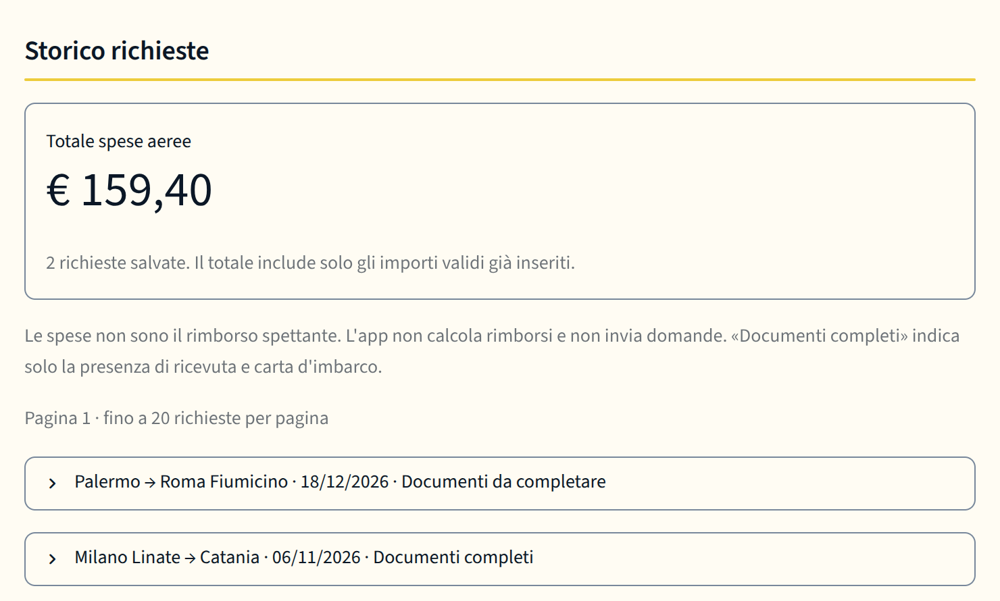

<h1 align="center">Caro Voli Sicilia</h1>

<p align="center">
  Salva la ricevuta quando prenoti, aggiungi la carta d’imbarco quando fai il check-in<br>
  e ritrova entrambi i PDF quando compili la domanda di rimborso.
</p>

<p align="center">
  
  
  
  
  
</p>

<p align="center">
  <strong><a href="https://rimborso-voli-sicilia.streamlit.app/">Apri l’app ↗</a></strong> ·
  <a href="#come-funziona">Come funziona</a> ·
  <a href="#avvio-locale">Avvio&nbsp;locale</a> ·
  <a href="#test">Test</a>
</p>



## Come funziona

1. **Quando prenoti**, accedi al tuo account, apri **Nuova richiesta** e carica la ricevuta. Puoi lasciare vuoti i campi che completerai più avanti.
2. **Prima di salvare**, inserisci i dati del volo a mano oppure premi **Leggi i nuovi documenti con AI**. Controlla il **costo della singola tratta**, soprattutto se la ricevuta include andata e ritorno o più passeggeri. Premi **Salva richiesta**.
3. **Quando fai il check-in**, apri il volo in **Storico richieste**, scegli **Modifica / aggiungi carta d’imbarco**, carica il documento e salva le modifiche.
4. **Per presentare la domanda**, apri il volo nello storico. Per ciascun documento scegli **Prepara download**, poi **Scarica**. Allega i PDF alla domanda che compili sul portale regionale Caro Voli Sicilia.

**«Documenti completi»** indica che hai archiviato sia la ricevuta sia la carta d’imbarco. Il totale nello storico somma le spese che hai registrato. L’app non calcola il rimborso e non invia la domanda.

## Documenti e privacy

**Caricamento.** Scegli un’immagine JPG, JPEG o PNG, fino a **10 MB per file**. I documenti della bozza restano nella sessione anche se passi allo storico. Salva prima di uscire per ritrovarli al prossimo accesso. Per cambiare un’immagine appena scelta, rimuovila dalla bozza e seleziona il nuovo file.

**Archivio personale.** Quando salvi, l’app conserva i dati del volo in Supabase e i PDF in un bucket privato. Le regole di accesso del database e dell’archivio limitano ciascun account alle proprie richieste e ai propri file.

**Lettura facoltativa.** Solo il pulsante di analisi invia a Groq, se configurato, copie JPEG ridotte dei nuovi documenti. Puoi sempre compilare i campi a mano. Se manca la chiave, il servizio è temporaneamente indisponibile, incontra un limite di quota o restituisce una risposta non valida, l’app prova a leggere le immagini con Tesseract sul server. Lo stesso vale per gli errori di rete. Con errori di configurazione, autorizzazione o modello, prosegui a mano.

## Avvio locale

Servono Python 3.14 e un progetto Supabase. Installa le dipendenze con [uv](https://docs.astral.sh/uv/) o `pip`. Se vuoi usare l’OCR, installa Tesseract con le lingue italiana e inglese e rendi disponibile il comando `tesseract` nel `PATH`.

### 1. Installa le dipendenze

```bash
git clone https://github.com/simone-cavallaro/rimborso_voli.git
cd rimborso_voli
uv sync --locked
```

Se usi `pip`, attiva un ambiente virtuale Python 3.14 ed esegui `python -m pip install -r requirements.txt`.

### 2. Configura i servizi

Crea `.streamlit/secrets.toml` nella cartella del progetto e sostituisci i valori di esempio. Per Supabase usa la chiave **publishable** o **anon**. Le chiavi privilegiate (`service_role`, `sb_secret_…`) non sono adatte all’app. Tieni il file dei segreti fuori da Git.

```toml
SUPABASE_URL = "https://IL-TUO-PROGETTO.supabase.co"
SUPABASE_KEY = "LA-TUA-CHIAVE-PUBLISHABLE"

# Facoltativo, per leggere i documenti con Groq
# GROQ_API_KEY = "LA-TUA-CHIAVE-GROQ"
# GROQ_MODEL = "qwen/qwen3.8-27b"
```

Se abiliti Groq, puoi usare il modello predefinito indicato nell’esempio. Prima di analizzare documenti reali, attiva **Zero Data Retention** nell’account Groq dove disponibile.

### 3. Prepara il database

Se il progetto Supabase contiene già richieste, fai prima un backup del database e dei documenti. Nel **SQL Editor** esegui questi script nell’ordine indicato.

| Ordine | Script | Scopo |
| --- | --- | --- |
| 1 | [preflight.sql](supabase/preflight.sql) | Controlla lo stato iniziale del progetto. |
| 2 | [requests_security.sql](supabase/migrations/202609250001_requests_security.sql) | Crea o aggiorna la struttura e le regole di accesso. |
| 3 | [verify_security.sql](supabase/verify_security.sql) | Verifica le policy RLS, il bucket privato e i dati preesistenti. |

### 4. Avvia Streamlit

```bash
uv run streamlit run app.py
```

Con `pip`, avvia l’app dallo stesso ambiente virtuale con `python -m streamlit run app.py`.

Prima di pubblicare su **Streamlit Community Cloud**, prepara il database come al punto 3. Scegli Python 3.14 e copia le stesse impostazioni nei Secrets della dashboard. Il servizio installa Tesseract e le lingue elencate in [packages.txt](packages.txt).

## Test

La suite Python usa dati sintetici e si esegue offline.

```bash
uv run python -m unittest discover -s tests -v
```

Per verificare anche le policy SQL in locale, installa le dipendenze di test con npm ed esegui i test con Node.js.

```bash
npm --prefix tests/sql ci --ignore-scripts
node --test tests/sql/security.test.mjs
```

<details>
<summary><strong>Diagnostico Groq · prova manuale e interpretazione degli errori HTTP 403</strong></summary>

Il [diagnostico](tests/check_groq.py) invia a Groq documenti sintetici generati in memoria, usando lo stesso client e lo stesso formato delle immagini dell’app. Serve un account Groq Free senza fatturazione attiva. Inserisci la chiave solo al prompt nascosto nel tuo terminale personale. Il diagnostico ignora la chiave e l’URL di base dell’ambiente e si ferma se trova la variabile `GROQ_CUSTOM_HEADERS`, anche vuota.

Scegli un caso per comando. Ogni esecuzione effettua al massimo una richiesta, senza tentativi automatici. Se ricevi HTTP 429, fermati e attendi che la quota torni disponibile.

```bash
uv run python -m tests.check_groq --case ricevuta
uv run python -m tests.check_groq --case imbarco
uv run python -m tests.check_groq --case entrambi
uv run python -m tests.check_groq --case ambiguo
```

L’output mostra l’esito, la durata e il confronto dei campi o, in caso di errore, una categoria e il codice HTTP se disponibile. Il codice di uscita è `0` quando tutti i campi coincidono.

| Categoria per HTTP 403 | Cosa verificare |
| --- | --- |
| Permesso modello bloccato | Chiedi all’amministratore di controllare l’accesso al modello per il progetto o l’organizzazione. |
| Permessi API Groq | Verifica con l’amministratore i permessi associati alla chiave. |
| Blocco accesso Cloudflare 1010 | Contatta l’assistenza Groq. |
| Configurazione/autorizzazione | Il corpo della risposta manca o non consente di identificare la causa. Controlla la configurazione. |

</details>

## Struttura del progetto

| Percorso | Contenuto |
| --- | --- |
| [`app.py`](app.py) | Punto di avvio per Streamlit. |
| [`rimborso_voli/`](rimborso_voli/) | Interfaccia, validazione, Groq, OCR, sessioni e archivio. |
| [`supabase/`](supabase/) | Migrazione e verifiche del database. |
| [`tests/`](tests/) | Test dell’app, del diagnostico e delle policy SQL. |
